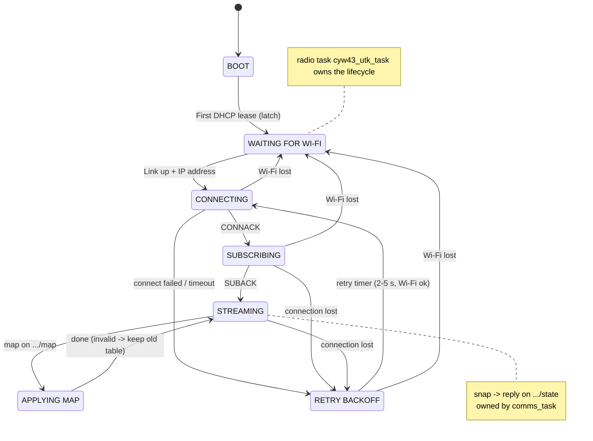

# Statechart 1 Diagram Spec — WiFi + Telemetry subsystem (corrected)

A build-ready specification for redrawing **Subsystem Statechart 1** ("WiFi and
MQTT communication") from `docs/embedded .md` §6.1. Hand this file to a diagram
agent; it contains every string, colour, arrow and layout rule needed.

- **Owner:** Buddy 1 (WiFi + Telemetry)
- **Status:** corrected 2026-10-10 to match the **Option A** decision (one
  application task, `comms_task`; the radio task `cyw43_utk_task` is unchanged).
- **Supersedes:** the previous raster ("radio task + wifi_task" in its NOTES).
- **Updated from Tribunal 1 (2026-10-19):** the `APPLYING MAP` check is now a
  7-byte binary table, and the Wi-Fi-loss fault bit is shown on the transitions
  (§3 note). Redraw with these strings.
- **Source of truth for behaviour:** `docs/comms/WIFI_SUBSYSTEM_DESIGN.md` §7, §9, §10,
  §16; `docs/comms/RTOS_INTERFACES.md` §7. If the diagram and those disagree, they win.

---

## 0. Deliverable (what the agent should produce)

- **Format:** a single **self-contained SVG** (preferred), or an HTML page with
  inline SVG, sized to landscape ~1600×1000. Escapable to PNG at 2× with no
  external assets, fonts, or scripts.
- **Style:** light grid background; rounded-rectangle state boxes; a bold title
  top-centre; three side panels (NOTES, LEGEND, EVENTS/TRIGGERS). Match the
  original's look — do **not** restyle.
- **A Mermaid source is provided in §8** as a text fallback if SVG is not
  possible, but the SVG is the requested artifact (Mermaid cannot express the
  colours, icons, or panel layout).

---

## 1. Title

> **WiFi + Telemetry — Subsystem Statechart**

Optional subtitle (recommended, new):
> Owner: Buddy 1 · Tasks: `cyw43_utk_task` (radio, lifecycle) + `comms_task`
> (application, side-flows)

---

## 2. Overall layout

Vertical **main chain** down the centre; **APPLYING MAP** to its left;
**RETRY BACKOFF** to its right; panels down the right margin.

```
        BOOT
          │ (latch)
   WAITING FOR WI-FI
          │
      CONNECTING ─────────────▶ RETRY BACKOFF
          │                          ▲   │
     SUBSCRIBING ────────────────────┘   │
          │                              │
      STREAMING ◀──▶ APPLYING MAP        │
          └──────────────────────────────┘
     RETRY BACKOFF ──▶ WAITING FOR WI-FI
```

Add a **task-ownership annotation** (new, §6): a brace/lane labelling which task
owns which states.

---

## 3. States (verbatim text)

| ID | Label | Subtitle | Bullets | Colour |
|---|---|---|---|---|
| BOOT | **BOOT** | (Radio up · waiting for first DHCP lease) | — | gray — startup |
| WAITING | **WAITING FOR WI-FI** | (No link or no IP address) | • Checked every 2 ms radio poll<br>• Buddies keep sending events | pale yellow — waiting |
| CONNECTING | **CONNECTING** | (New MQTT client · clean session) | • Waiting for the broker's CONNACK | pale yellow — connecting |
| SUBSCRIBING | **SUBSCRIBING** | (To `…/cmd` and `…/map`) | • Retained map arrives → applied<br>• SUBACK verdict logged<br>• Refused → log + retry | orange — joining |
| STREAMING | **STREAMING** | (Normal operation) | • `S` line every 1 s (+ heartbeat)<br>• `E` line the moment an event happens<br>• Commands from the laptop handled | green — online |
| APPLYING MAP | **APPLYING MAP** | (Barcode remap from laptop) | • Check 7 bytes: version + 26 × 2-bit codes<br>• Send table to `barcode_task`  ⟵ *see §7 note*<br>• Report `mpv = mv` in the next `S` line | purple — command handling |
| RETRY BACKOFF | **RETRY BACKOFF** | (Connection lost) | • Disconnect + free the client<br>• Wait 2–5 s (only 6 TCP slots)<br>• Lost lines show as an `s=` gap | red/pink — recovery |

> **Updated from Tribunal 1 (2026-10-19) — the Wi-Fi-loss fault bit.** Add one
> annotation to the diagram: entering **WAITING FOR WI-FI** or **RETRY
> BACKOFF** from a connected state **sets the Wi-Fi-loss bit** in the shared
> fault bitmask; reaching **STREAMING** again **clears it** (after the first
> `S` line has carried it). `S` and `E` records are packed binary (schema v2),
> so the STREAMING bullets stay as they are.

Topic placeholders `…/cmd`, `…/map`, `…/state` may be written in full as
`robocar/<id>/cmd` etc. if space allows (`<id>` = the car's client id).

---

## 4. Transitions (verbatim labels + arrow style)

| From | To | Label | Arrow |
|---|---|---|---|
| BOOT | WAITING | First DHCP lease (latch) | solid black |
| WAITING | CONNECTING | Link up + IP address | solid black |
| CONNECTING | SUBSCRIBING | Broker accepts (CONNACK) | solid black |
| SUBSCRIBING | STREAMING | Subscriptions confirmed (SUBACK) | solid black |
| CONNECTING | RETRY BACKOFF | Connect failed / timeout | red dashed |
| SUBSCRIBING | RETRY BACKOFF | Connection lost | red dashed |
| STREAMING | RETRY BACKOFF | Connection lost | red dashed |
| RETRY BACKOFF | CONNECTING | Timer fires (Wi-Fi ok) | solid black |
| RETRY BACKOFF | WAITING | Wi-Fi lost (from any connected state) | red dashed |
| STREAMING | WAITING | Wi-Fi lost | red dashed |
| STREAMING | APPLYING MAP | map on `…/map` | blue dashed |
| APPLYING MAP | STREAMING | Done (invalid → keep old table) | blue dashed |
| STREAMING | STREAMING | snap → reply on `…/state` | blue dashed (self-loop or side annotation) |

**Transitions to draw explicitly:** *Wi-Fi lost* from **CONNECTING**,
**SUBSCRIBING** and **STREAMING** straight to **WAITING FOR WI-FI** (the first
version only showed it from RETRY BACKOFF, which is incomplete — see §7). The
design backs this: `WIFI_SUBSYSTEM_DESIGN.md` §10.1 — the per-poll guard resets
to `WAIT_ADDR` whenever the link goes down, from any state.

---

## 5. Panels (verbatim text)

### NOTES
- System-level view of Buddy 1's subsystem (**`cyw43_utk_task`** + **`comms_task`**).
- Queue names, callbacks and lwIP calls are in tab 7.
- Wi-Fi can drop in **any** connected state → WAITING FOR WI-FI.
- The car keeps driving in every state: buddies never block on telemetry.
- Never returns to BOOT: DHCP completion is a latch.

### LEGEND
Colour swatches:
- gray — Startup
- pale yellow — Waiting / Connecting
- orange — Joining (subscribe)
- green — Online
- purple — Command handling
- red/pink — Recovery

Line samples:
- solid black — Normal transition
- red dashed — Link / connection loss
- blue dashed — Command from laptop

### EVENTS / TRIGGERS
- First DHCP lease
- Link up + IP address
- CONNACK / SUBACK from broker
- Connect failed / connection lost
- Wi-Fi lost
- Retry timer (2–5 s)
- map / snap from the laptop

---

## 6. Task-ownership annotation (NEW — this is what made the old version feel incomplete)

Annotate **which RTOS task owns which states**, because the subsystem is two
tasks, not one:

- **`cyw43_utk_task`** (radio-owner, 2 ms poll, the only MQTT caller) owns the
  lifecycle: **BOOT, WAITING FOR WI-FI, CONNECTING, SUBSCRIBING, STREAMING,
  RETRY BACKOFF**. Draw a brace/bracket on the left spanning these.
- **`comms_task`** (the single application task) owns the command side-flows:
  **APPLYING MAP** and the **snap** reply. Draw a brace on the right.

> Rationale string for the drawing: *"The radio task owns the connection
> lifecycle; the application task only prepares traffic and dispatches
> commands — it never touches lwIP."*

---

## 7. Corrections vs the previous diagram (and what to confirm)

1. **NOTES said "radio task + `wifi_task`".** `wifi_task` was renamed to
   **`comms_task`** and merged into one application task. Fixed in §5.
2. **APPLYING MAP target name.** Three names exist for the consumer of the
   barcode table: your own design says **`line_task`** (`WIFI_SUBSYSTEM_DESIGN.md`
   §3 and §9, via `tele_cmd_mbfid`); the §6.1 prose says `ir_sense_task`; the
   team's task table says `barcode_task`. This spec used `barcode_task` (the team
   doc's name). **Confirm with Buddy 3** and make the diagram, the §6.1 prose and
   the task table agree on one name — if you want the diagram to match your own
   design docs, it should read `line_task`.
   *Settled 2026-10-29:* `barcode_task`, through Buddy 3's `map_mbf` (the
   submitted Tribunal report and Buddy 3's `app_main.c` code); the design docs
   now say so.
3. **Wi-Fi-lost-from-anywhere was under-drawn.** Add the explicit transitions
   from CONNECTING, SUBSCRIBING and STREAMING to WAITING FOR WI-FI (§4).
4. **Task ownership was only in NOTES.** Now drawn as lanes (§6).

### Optional enhancements (only if the agent has room; not required)
- A small **outbound inset**: `buddies → [tele_mbfid] → comms_task →
  [tele_pub_mbfid] → cyw43_utk_task → broker`, with a caption *"drop on full
  queue, count as `drp=`"*. This is the one path with no picture today.
- Annotate the reporter task `wifi_status_task` (read-only, priority 8) as a
  dashed observer off STREAMING.

---

## 8. Mermaid fallback source



---

## 9. Glossary for the diagram author

> **Moved.** Every term is collected in the shared [`GLOSSARY.md`](GLOSSARY.md) — one copy for the whole `docs/comms/` set.

---

## 10. Review of the rendered diagram (2026-10-10)

The produced diagram is **faithful to this spec** and even includes the optional
extras (outbound inset, `wifi_status_task` observer, the `†` note). Verified
correct: the outbound mailbox names (`tele_mbfid`, `tele_pub_mbfid`), all states
and subtitles, the panels, the task-ownership lanes, and the recovery arrows.

Two things to fix or confirm in the drawing:

1. **Add `STREAMING → WAITING FOR WI-FI` on "Wi-Fi lost".** The first version
   carries it only from CONNECTING and SUBSCRIBING (plus a generic arrow). §10.1
   of the design resets to `WAIT_ADDR` from **any** state when the link drops, so
   the main state needs it too — §4 now lists it.
2. **Decide the APPLYING MAP target name** (§7 note 2): `line_task` (your design)
   vs `barcode_task` (team doc) vs `ir_sense_task` (6.1 prose). The `†` flag is in
   place; pick one with Buddy 3.

Minor check: confirm **RETRY BACKOFF sits inside the `cyw43_utk_task` lane** — it
is a radio lifecycle state, so the blue brace should enclose it.